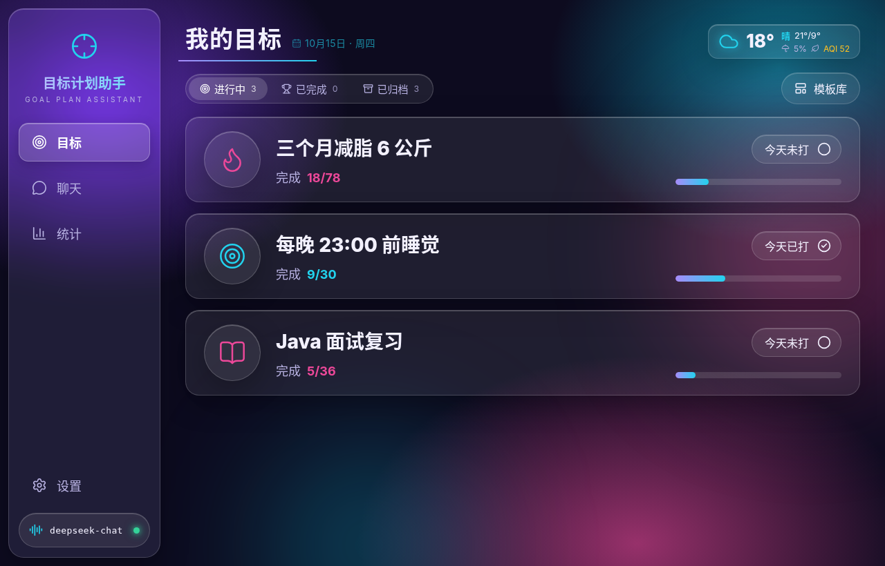
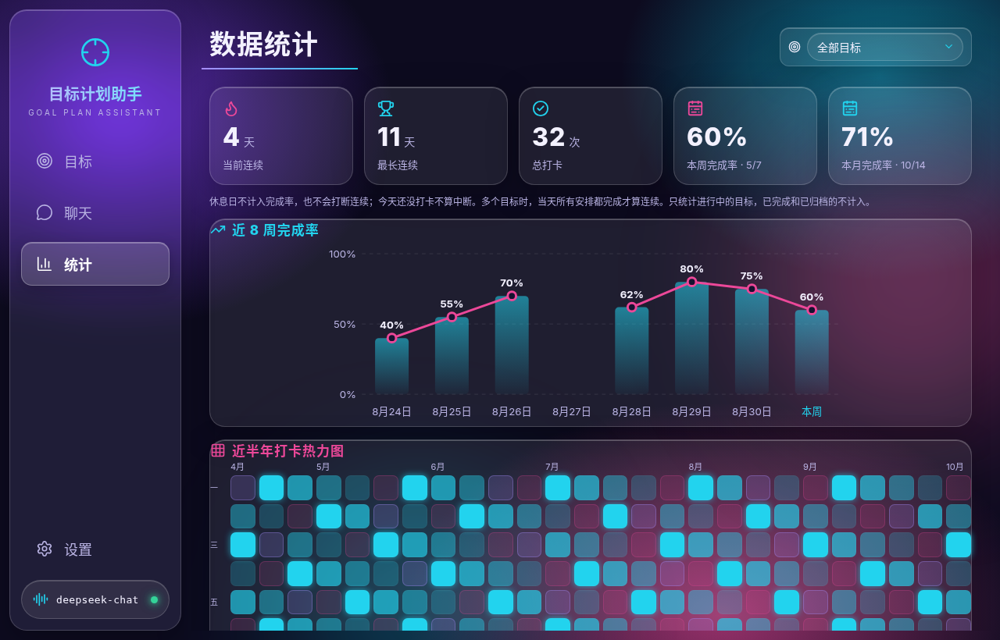
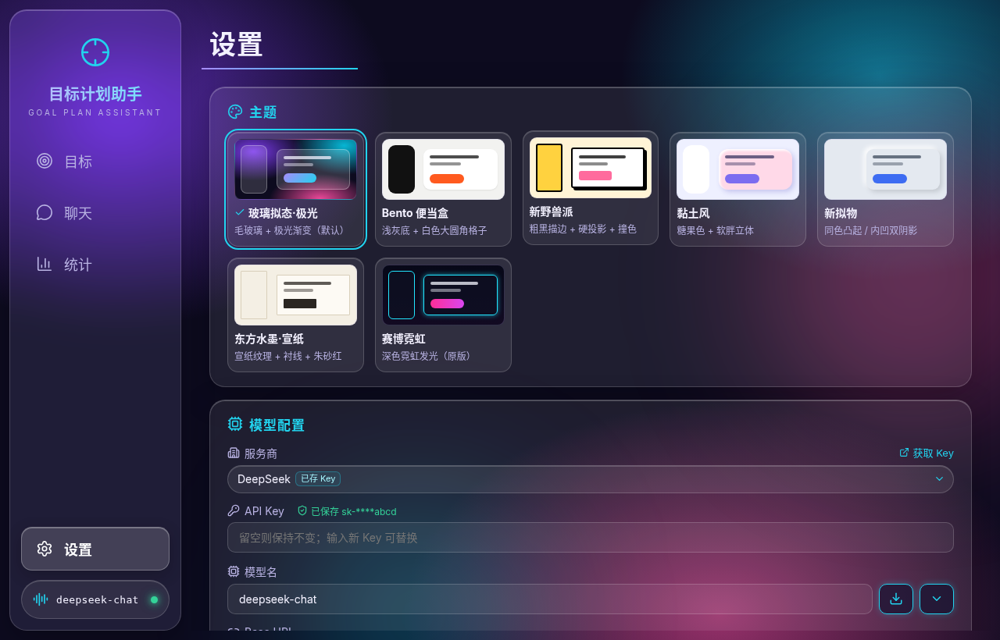
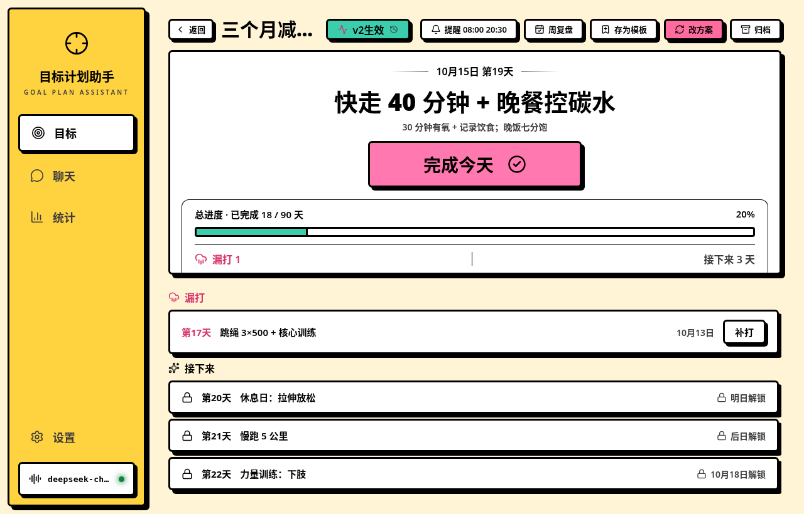
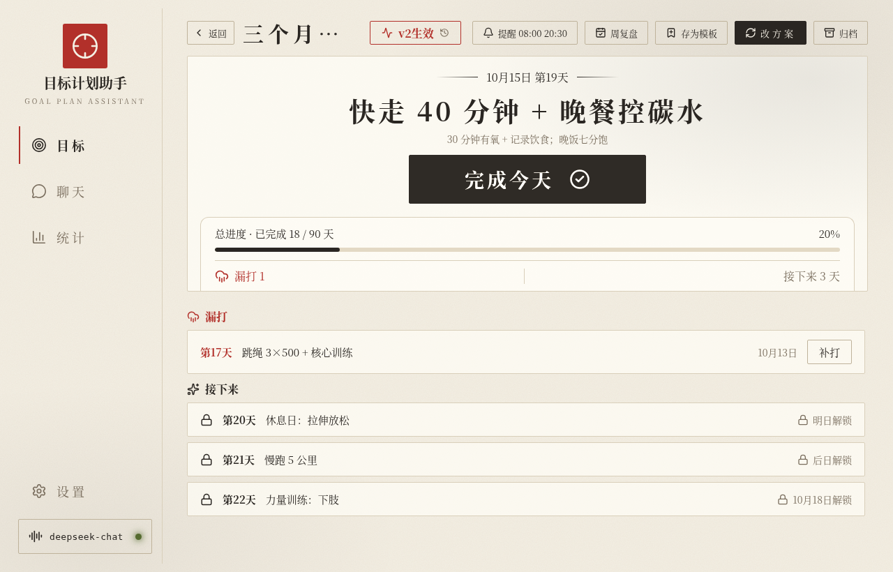

# 目标计划助手

一个本地运行的 Windows 桌面应用：先和 AI 助手聊清楚目标，确认后自动生成「目标 + 按天计划」，之后每天打卡、每周复盘，用统计页看坚持情况。数据全部存在本机，离线也能查看和打卡。

基于 Tauri 2 + React 19 + Rust + SQLite。

## 截图

> 以下截图使用**示例数据**拍摄，不是真实用户数据。

| 目标列表（玻璃拟态·极光） | 目标详情（玻璃拟态·极光） |
| --- | --- |
|  |  |
| **数据统计（玻璃拟态·极光）** | **设置 · 主题切换（玻璃拟态·极光）** |
|  |  |
| **目标详情（新野兽派）** | **目标详情（东方水墨·宣纸）** |
|  |  |

## 功能

- **对话式制定计划**：在「聊天」页和助手一问一答（每轮只问一个问题，并给出可点选的选项），把目标、时间、现状问清楚后给出计划草案。
- **确认后生成目标和按天计划**：确认草案即创建目标及每天的任务（含休息日），可选择从今天或明天开始。之后可以「改方案」，继续和助手对话生成新版本计划，已过去的天数保留，新版本从当前进度往后替换。
- **打卡**：每天完成后打卡，漏打的天可以补打，也可以撤销；未到的日期锁定，到期才解锁。
- **周回顾**：按周查看完成/漏打情况，手写「做得好 / 困难 / 下周计划」，可请助手点评。
- **统计页**：当前连续天数、最长连续、总打卡、本周/本月完成率、近 8 周完成率趋势、近半年打卡热力图、各目标排行；可按单个目标筛选。只统计进行中的目标。
- **模板库**：内置 4 个 30 天模板，每天都有具体可打卡的任务：
  - 30 天塑形减脂：热量缺口 + 饮食记录 + 力量和有氧，逐周递进。
  - 30 天每天阅读一小时：选书、分段阅读、笔记、每周复盘。
  - 30 天养成早睡早起：先固定起床时间，再渐进提前入睡，配合睡前仪式和屏幕管理。
  - 30 天学会用 AI：对话技巧、提示词、写作、办公、搜索、图像工具、自动化，最后完成一个小项目。

  也可以把自己的目标存为模板，一键套用。
- **目标状态**：进行中 / 已完成 / 已归档。计划全部走完自动变为「已完成」，可手动归档；目标页按三个标签分开显示，已归档目标只读，可恢复。
- **7 套主题**：玻璃拟态·极光（默认）、Bento 便当盒、新野兽派、黏土风、新拟物、东方水墨·宣纸、赛博霓虹。在设置里点选，立即生效并保存。
- **天气**：侧栏显示所选城市的天气、空气质量和出行建议（数据来自 Open-Meteo，无需 Key），带 30 分钟缓存，离线时显示上次缓存。
- **托盘和关闭行为**：关闭窗口时可选「每次询问 / 隐藏到托盘 / 直接退出」；隐藏到托盘后仍会按时提醒。只允许运行一个实例。
- **开机自启和通知**：可设置开机自启；可给每个目标设置每天的提醒时间，并支持每日小结提醒（默认 22:00），通过系统通知弹出。
- **离线查看与打卡**：目标、计划、打卡、统计都在本地，不联网也能用；只有和助手对话、AI 点评、天气需要网络。
- **备份导入导出**：把目标、计划版本、打卡、聊天、周复盘、提醒、自建模板和设置导出为一个 JSON 文件，也可以从备份恢复。备份不包含 API Key。设置里还有「恢复出厂设置」。
- **多模型支持**：内置 DeepSeek、通义千问（阿里云百炼兼容模式）、Kimi（Moonshot）、智谱 GLM，以及「自定义（OpenAI 兼容）」。在设置里填 API Key、Base URL 和模型名即可；支持从服务商拉取模型列表，并可测试连接。侧栏实时显示模型在线状态。

## 技术栈

- **桌面框架**：Tauri 2（插件：dialog、notification、autostart、opener、single-instance，托盘图标）
- **前端**：React 19 + TypeScript + Vite，图标用 lucide-react，样式为手写 CSS（CSS 变量 + `data-theme` 主题切换）
- **后端**：Rust，rusqlite（内置 SQLite）、reqwest（rustls，用于模型接口的 SSE 流式输出和天气）、keyring（Windows 凭据管理器）、tokio、chrono、serde

## 目录结构

```
goal-plan-assistant/
├─ index.html               # 入口页（首帧前套用主题）
├─ src/                     # 前端
│  ├─ App.tsx
│  ├─ layout/AppShell.tsx   # 侧栏 + 主区域
│  ├─ pages/                # 目标、目标详情、聊天、周回顾、统计、模板、设置
│  ├─ components/           # 下拉框、Markdown、状态指示、天气卡、关闭对话框
│  ├─ lib/                  # tauri.ts（后端命令封装）、theme.ts（主题）
│  └─ styles/               # cyber-neon.css（基础样式）+ themes/（各主题）
├─ src-tauri/               # Rust 后端
│  ├─ src/
│  │  ├─ db.rs              # 建表与数据库迁移
│  │  ├─ service.rs         # 目标、计划、打卡
│  │  ├─ chat.rs / llm.rs / sse.rs / draft.rs / revise.rs   # 对话、模型调用、草案、改方案
│  │  ├─ providers.rs / secret.rs   # 模型服务商、API Key 存储
│  │  ├─ review.rs / stats.rs / templates.rs / weather.rs
│  │  ├─ reminder.rs        # 提醒、关闭行为、主题等设置
│  │  ├─ backup.rs          # 备份导入导出
│  │  └─ commands.rs / lib.rs / main.rs
│  ├─ Cargo.toml
│  └─ tauri.conf.json
├─ docs/                    # 设计文档与截图
└─ package.json
```

## 环境要求

- Windows 10/11（API Key 存在 Windows 凭据管理器中；目前只针对 Windows 开发和测试）
- Node.js 与 npm
- Rust 稳定版工具链（MSVC），以及 Tauri 2 所需的 WebView2 和 Visual Studio C++ 生成工具，参见 [Tauri 前置条件](https://v2.tauri.app/start/prerequisites/)

## 开发运行

```bash
npm install
npm run tauri dev
```

运行后端测试：

```bash
cd src-tauri
cargo test
```

## 打包

```bash
npm run tauri build
```

NSIS 安装包输出到：

```
src-tauri/target/release/bundle/nsis/目标计划助手_0.1.0_x64-setup.exe
```

## 数据存储与隐私

- **本地 SQLite**：所有目标、计划、打卡、聊天、复盘、设置都保存在本机数据库：
  `%APPDATA%\com.luoke.goalplanassistant\goal_plan.db`
- **API Key**：每个服务商的 Key 单独存放在 Windows 凭据管理器（服务名 `goal-plan-assistant`），不写入数据库、日志或备份文件，界面上只显示掩码。「恢复出厂设置」会一并删除已保存的 Key。
- **网络请求**：只在以下两种情况联网：
  - 和助手对话、请求 AI 点评时，内容会发送给你配置的模型服务商；
  - 获取天气时请求 Open-Meteo。

  此外没有任何统计或上报。
- 仓库已在 `.gitignore` 中忽略 `*.db` 和 `.env`。

## 路线图

- [ ] macOS / Linux 适配（API Key 存储改用各平台的系统密钥库）
- [ ] 更多内置模板
- [ ] 计划导出为日历（ICS）
- [ ] 多设备之间同步数据（可选，默认仍为纯本地）
- [ ] 应用内自动更新

## 许可证

暂未指定。
