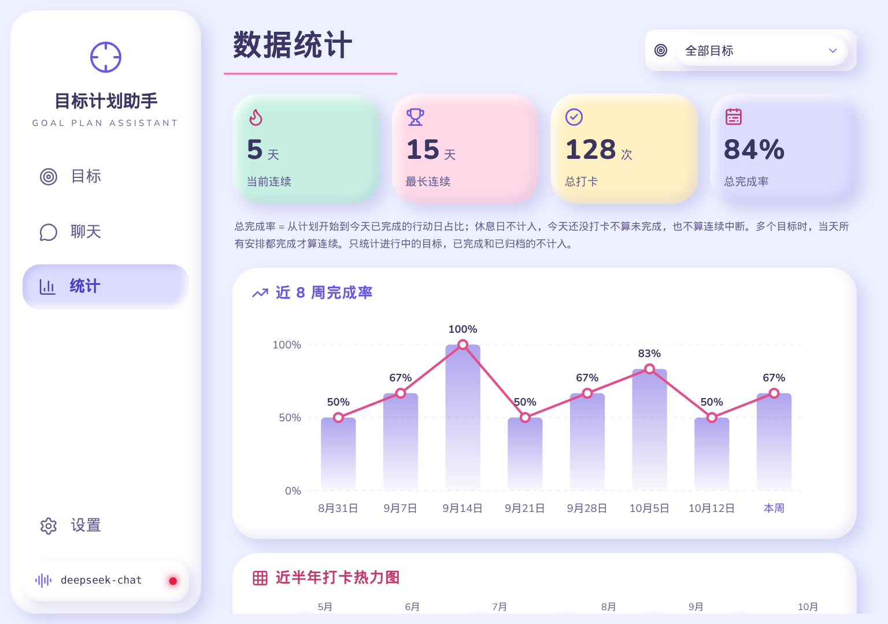
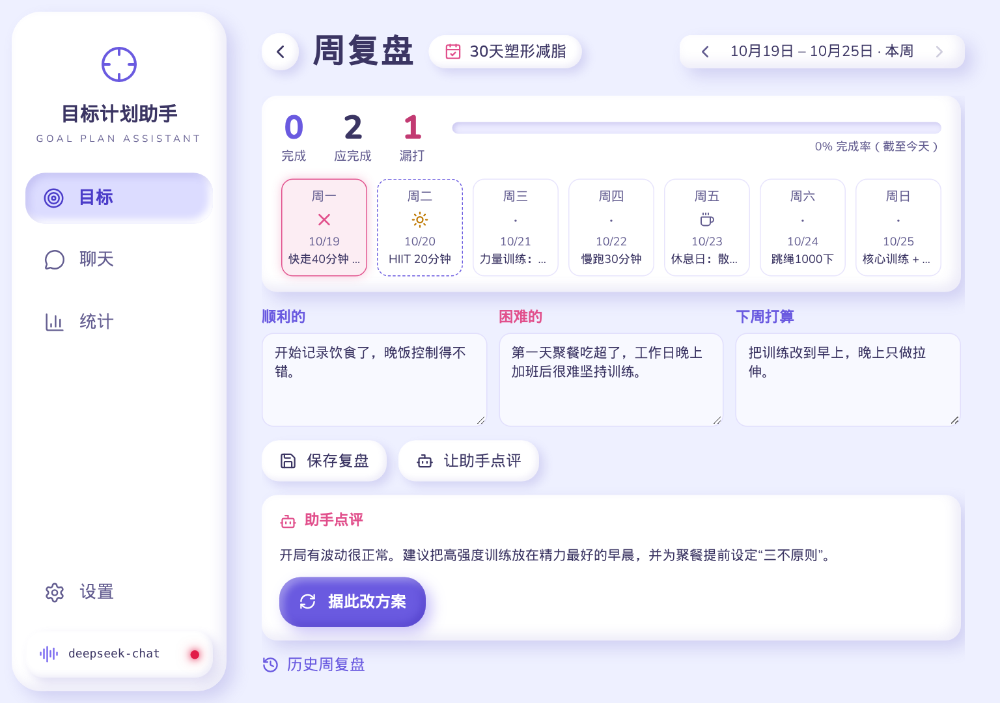
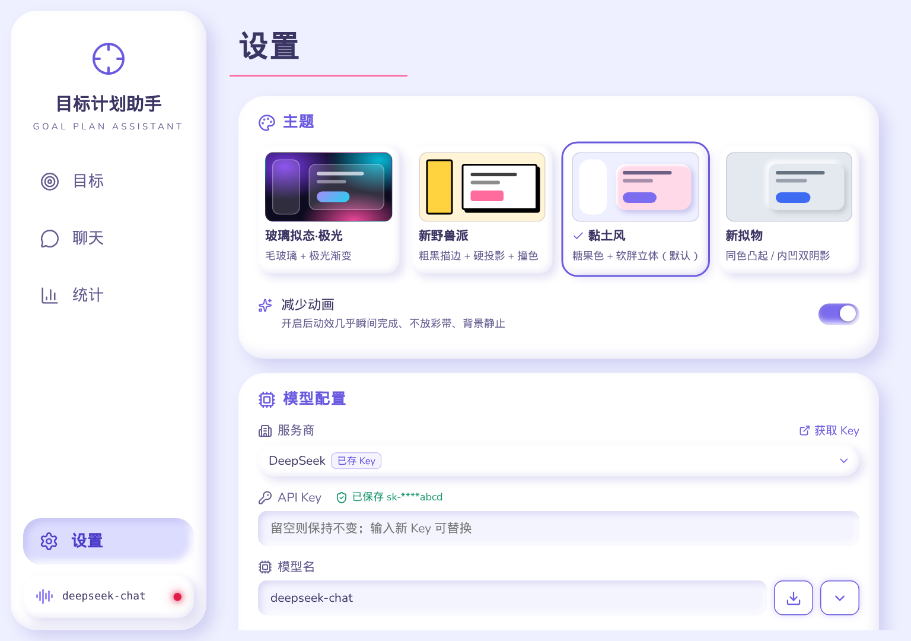

# 目标计划助手

一个本地运行的 Windows 桌面应用：先和 AI 助手把目标聊清楚，确认后自动生成「目标 + 按天计划」，之后每天打卡、每周复盘，计划结束时写最终总结，用统计页看坚持情况。数据全部存在本机，离线也能查看和打卡。

基于 Tauri 2 + React 19 + Rust + SQLite。

## 截图

> 以下截图使用**示例数据**、黏土风（默认主题）拍摄，不含真实用户数据或 API Key。

| 目标详情 | 数据统计 |
| --- | --- |
|  |  |
| **周复盘** | **设置 · 主题** |
|  |  |

## 核心功能

### 目标与计划
- **对话式制定计划**：在「聊天」页和助手一问一答（每轮只问一个问题，并给出可点选的选项），把目标、时间、现状问清楚后给出计划草案。
- **确认后生成目标和按天计划**：确认草案即创建目标及每天的任务（含休息日），可选择从今天或明天开始。
- **改方案与版本**：随时「改方案」，继续和助手对话生成新版本计划；已过去的天数保留，新版本从当前进度往后替换。可在版本记录里查看历次版本。
- **目标状态**：进行中 / 已完成 / 已归档。计划全部走完自动变为「已完成」，可手动归档；目标页按三个标签分开显示，已归档目标只读，可恢复。

### 每天打卡
- **今天优先**：目标详情顶部是「今天」卡片，一键「完成今天」，打卡时有庆祝动效（可关闭）。
- **补打与撤销**：漏打的天集中列在「漏打」区，可补打；打错可撤销。未到的日期锁定，到期才解锁。
- **休息日**：计划里的休息日不需要打卡，不计入完成率，也不打断连续天数。
- **每日备注**：每一天都可以写一句备注（做了什么、感受如何），随时编辑或删除。
- **已完成列表**：已打卡的天收在底栏的「已完成」入口里，展开查看、可收起。

### 复盘与总结
- **周复盘**：按周查看完成/漏打情况，手写「顺利的 / 困难的 / 下周打算」，可请助手点评，也可以从点评直接去改方案；可翻看历史周复盘。
- **最终总结**：计划结束后，可回顾整个计划的每一天，写下总结，或让助手生成一份总结。

### 统计
- 当前连续、最长连续、总打卡、总完成率四项指标；近 8 周完成率趋势；近半年打卡热力图（区分完成度、休息日、无计划）；各目标完成率排行。可按单个目标筛选。
- 口径：只统计进行中的目标；休息日不计入；今天还没打卡不算未完成、也不算连续中断；多个目标时当天所有安排都完成才算连续。

### 模板库
内置 4 个 30 天模板，每天都有具体可打卡的任务：
- 30 天塑形减脂：热量缺口 + 饮食记录 + 力量和有氧，逐周递进。
- 30 天每天阅读一小时：选书、分段阅读、笔记、每周复盘。
- 30 天养成早睡早起：先固定起床时间，再渐进提前入睡，配合睡前仪式和屏幕管理。
- 30 天学会用 AI：对话技巧、提示词、写作、办公、搜索、图像工具、自动化，最后完成一个小项目。

可预览完整计划、选择开始日期一键套用，也可以把自己的目标存为模板。

### 聊天
多会话：新建、重命名、删除（可撤销）；回复流式输出，可随时停止；每个目标有自己的对话。

### 提醒、托盘与开机自启
- **打卡提醒**：可给每个目标设置每天的提醒时间（在目标详情右上角「提醒」里设置），到点仍未打卡就弹系统通知。
- **睡前汇总**：可开启每日汇总（默认 22:00，可改），到点列出今天还没打卡的目标；都打完了就不打扰。
- **关闭窗口行为**：每次询问 / 隐藏到托盘 / 直接退出。隐藏到托盘后仍按时提醒；只允许运行一个实例。
- **开机自启**：开启后开机静默运行在托盘并按时提醒。

### 其它
- **天气卡**：目标页右上角显示所选城市的天气、空气质量（数据来自 Open-Meteo，无需 Key），30 分钟内不重复请求，离线时显示上次结果。可在设置中关闭或更换城市。
- **主题与动画**：4 套主题——黏土风（默认）、玻璃拟态·极光、新野兽派、新拟物，点选立即生效并保存。「减少动画」开启后动效几乎瞬间完成、不放彩带、背景静止；系统开启「减少动态效果」时自动减少。
- **更改数据位置**：可以把数据库搬到任意文件夹（如同步盘、U 盘），详见下文。
- **备份与恢复**：把目标、计划版本、打卡、备注、聊天、周复盘、最终总结、提醒、自建模板和设置导出为一个 JSON 文件，也可以从备份恢复（恢复前会预览内容）。备份不包含 API Key。设置里还有「恢复出厂设置」。
- **离线可用**：目标、计划、打卡、统计都在本地，不联网也能用；只有和助手对话、AI 点评/总结、天气需要网络。

## 下载安装

目前还没有发布预编译安装包（GitHub Releases 暂无版本），请按下文「开发 → 打包」自行构建，得到 NSIS 安装包 `目标计划助手_0.1.0_x64-setup.exe` 后双击安装。仅支持 Windows 10/11（需要 WebView2，Windows 11 自带）。

## 配置模型与 API Key

在「设置 → 模型配置」中选择服务商、填写 API Key，并选择或输入模型名，点「保存」后可「测试连接」。支持从服务商拉取可用模型列表。侧栏底部实时显示当前模型和在线状态，点击可立即重新检测。

内置服务商（均为 OpenAI 兼容接口）：

| 服务商 | 默认 Base URL |
| --- | --- |
| DeepSeek | `https://api.deepseek.com` |
| 通义千问（阿里云百炼 · 兼容模式） | `https://dashscope.aliyuncs.com/compatible-mode/v1` |
| Kimi（月之暗面 Moonshot） | `https://api.moonshot.cn/v1` |
| 智谱 GLM | `https://open.bigmodel.cn/api/paas/v4` |
| 自定义（OpenAI 兼容） | 自行填写 |

每个服务商的 Key 分别保存在 Windows 凭据管理器，界面只显示掩码。

## 提醒规则

- 提醒由应用后台每 30 秒检查一次，**需要应用窗口或托盘图标在运行**；完全退出后不会提醒（可开启「开机自启」+「隐藏到托盘」保证常驻）。
- 到点后 30 分钟内仍会补发（例如电脑刚唤醒）；同一提醒每天只发一次。
- 只提醒进行中的目标、今天有安排且不是休息日、还没打卡的；已打卡就不再提醒。
- 设置里的「启用提醒」是总开关。

## 数据与隐私

- **本地 SQLite**：所有目标、计划、打卡、聊天、复盘、设置都保存在本机数据库 `goal_plan.db`，默认位置：
  `%APPDATA%\com.luoke.goalplanassistant\goal_plan.db`
- **自定义数据库位置**：在「设置 → 运行状态」里可以「更改位置」「打开所在文件夹」「恢复默认位置」。
  - 迁移时先合并 WAL 日志，把数据库复制到新文件夹并校验完整性和各表行数，确认无误后才切换；运行中即时生效，无需重启。
  - 原文件不删除，改名为 `goal_plan.db.bak` 留作备份。
  - 如果新文件夹里已有 `goal_plan.db`，会询问是使用那份数据，还是用当前数据覆盖；覆盖时旧文件先改名为 `.replaced.bak`。
  - 所选位置记录在 `%APPDATA%\com.luoke.goalplanassistant\config.json`，不写进数据库，也不进备份文件。
  - 启动时如果所选位置找不到数据库（比如 U 盘没插），会弹窗提示，可以重试、重新选择位置或回到默认位置，不会悄悄新建空库。
  - 恢复出厂设置只清空数据，保留你选的位置。
- **API Key**：每个服务商的 Key 单独存放在 Windows 凭据管理器（服务名 `goal-plan-assistant`），不写入数据库、日志或备份文件，界面上只显示掩码。「恢复出厂设置」会一并删除已保存的 Key。
- **网络请求**：只在以下两种情况联网：
  - 和助手对话、请求 AI 点评时，内容会发送给你配置的模型服务商；
  - 获取天气时请求 Open-Meteo。

  此外没有任何统计或上报。
- 仓库已在 `.gitignore` 中忽略 `*.db` 和 `.env`。

## 开发

### 环境要求

- Windows 10/11（API Key 存在 Windows 凭据管理器中；目前只针对 Windows 开发和测试）
- Node.js 与 npm
- Rust 稳定版工具链（MSVC），以及 Tauri 2 所需的 WebView2 和 Visual Studio C++ 生成工具，参见 [Tauri 前置条件](https://v2.tauri.app/start/prerequisites/)

### 运行与测试

```bash
npm install
npm run tauri dev        # 开发运行（前端热更新）
npx tsc --noEmit         # 前端类型检查
cd src-tauri && cargo test   # 后端单元测试
```

### 打包

```bash
npm run tauri build
```

NSIS 安装包输出到 `src-tauri/target/release/bundle/nsis/目标计划助手_0.1.0_x64-setup.exe`。

### 技术栈

- **桌面框架**：Tauri 2（插件：dialog、notification、autostart、opener、single-instance，托盘图标）
- **前端**：React 19 + TypeScript + Vite，图标用 lucide-react，样式为手写 CSS（CSS 变量 + `data-theme` 主题切换）
- **后端**：Rust，rusqlite（内置 SQLite）、reqwest（rustls，用于模型接口的 SSE 流式输出和天气）、keyring（Windows 凭据管理器）、tokio、chrono、serde

### 目录结构

```
goal-plan-assistant/
├─ index.html               # 入口页（首帧前套用主题）
├─ src/                     # 前端
│  ├─ App.tsx
│  ├─ layout/AppShell.tsx   # 侧栏 + 主区域
│  ├─ pages/                # 目标、目标详情、聊天、周复盘、最终总结、统计、模板、设置
│  ├─ components/           # 下拉框、Markdown、模型状态、天气卡、确认弹窗、关闭/数据库位置对话框等
│  ├─ lib/                  # tauri.ts（后端命令封装）、theme.ts（主题）、motion.ts（动效）
│  └─ styles/               # cyber-neon.css（基础样式）+ themes/（各主题）
├─ src-tauri/               # Rust 后端
│  ├─ src/
│  │  ├─ db.rs              # 建表与数据库结构迁移
│  │  ├─ dblocation.rs      # 数据库存放位置（config.json）与迁移
│  │  ├─ service.rs         # 目标、计划、打卡
│  │  ├─ chat.rs / llm.rs / sse.rs / draft.rs / revise.rs   # 对话、模型调用、草案、改方案
│  │  ├─ providers.rs / secret.rs   # 模型服务商、API Key 存储
│  │  ├─ review.rs / stats.rs / templates.rs / weather.rs
│  │  ├─ reminder.rs        # 提醒、关闭行为、主题等设置
│  │  ├─ backup.rs          # 备份导入导出
│  │  └─ commands.rs / lib.rs / main.rs
│  ├─ Cargo.toml
│  └─ tauri.conf.json
├─ docs/                    # 设计文档与截图
└─ package.json
```

## 常见问题

**没有配置 API Key 能用吗？**
能。打卡、补打、备注、统计、模板、复盘手写、备份等都不需要模型；只有和助手聊天、AI 点评和 AI 总结需要。

**为什么没收到提醒？**
确认应用或托盘图标在运行、「启用提醒」已打开、该目标设置了提醒时间且今天还没打卡；也检查 Windows 的通知设置和专注助手（勿扰）是否屏蔽了通知。

**换电脑或重装后怎么迁移数据？**
在「设置」里导出备份，到新电脑导入；或者把数据库放在同步盘里，新电脑上「更改位置」指向那个文件夹。API Key 不在备份里，需要重新填写。

**休息日会影响连续天数吗？**
不会。休息日既不计入完成率，也不会打断连续。

**之前用的主题不见了？**
旧版本的便当盒、赛博霓虹、东方水墨主题已移除，保存过这些主题的会自动切换为黏土风，可在设置里另选。

## 路线图

- [ ] macOS / Linux 适配（API Key 存储改用各平台的系统密钥库）
- [ ] 更多内置模板
- [ ] 计划导出为日历（ICS）
- [ ] 多设备之间同步数据（可选，默认仍为纯本地）
- [ ] 应用内自动更新

## 许可证

暂未指定。
